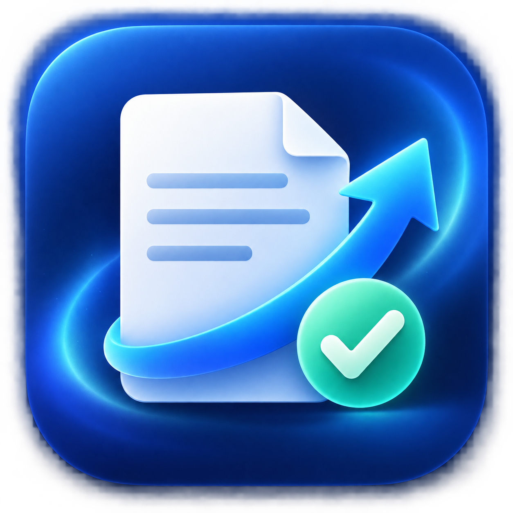

# Cover Letter Filler

<p align="center">
  
</p>

<p align="center">
  A native macOS app that fills an existing Word cover-letter template and saves a polished, country-specific PDF — entirely on your Mac.
</p>

## Why it exists

Job applications often require a cover letter tailored with small factual changes: the date, hiring manager, company, target role, and location. Re-editing a Word document manually is slow and creates duplicate files.

Cover Letter Filler keeps one Word template per target region, discovers its square-bracket placeholders, and creates a PDF with the same base filename in the matching destination folder. The original DOCX is never changed.

## Features

- Country workspaces for **India**, **Dubai UAE**, **Europe**, and **United States**.
- Per-country source and PDF destination folders, configured from the app.
- A macOS calendar for `[Date]`, editable values for all other placeholders, and country-aware city defaults.
- Replaces every occurrence of the same placeholder, even when Word has split it across XML runs.
- Confirms before replacing an existing PDF.
- Generates a temporary filled DOCX, converts it locally, and removes the temporary files afterwards.
- No account, API key, cloud service, or network connection at runtime.
- A private, offline LibreOffice rendering engine is embedded in release builds; end users never select or configure a converter.

## Quick start

### Requirements

| For | Requirement |
| --- | --- |
| Running a release build | macOS 14 Sonoma or later, Apple silicon |
| Developing | Xcode Command Line Tools and Swift 6 |
| Creating a distributable app | LibreOffice installed locally at build time |
| DOCX processing | macOS system `zip` and `unzip` utilities |

The final app includes its document renderer. LibreOffice is needed only by a developer building a new `.app` bundle.

### Run during development

```zsh
git clone https://github.com/CoollLzZ/cover-letter-filler.git
cd cover-letter-filler

# Point the debug build at a locally installed LibreOffice renderer.
SOFFICE_PATH="/Applications/LibreOffice.app/Contents/MacOS/soffice" swift run CoverLetterFiller
```

### Configure folders in the app

1. Select a country in the sidebar.
2. Open **Folder settings**.
3. Set the **Word source** folder that contains your cover-letter DOCX.
4. Set the **PDF destination** folder for the generated letter.
5. Repeat for any other country you use.

The suggested layout is:

```text
~/Documents/Final Job Applications 2026/
├── India/
├── Dubai UAE/
├── Europe/
├── United States/
└── PDF/
    ├── India/
    ├── Dubai UAE/
    ├── Europe/
    └── United States/
```

The choices are saved in local macOS preferences. Nothing is uploaded.

## Configure your template placeholders

Use a normal `.docx` cover letter. Add square-bracket placeholders anywhere Word text normally appears. The app reads the placeholders that actually exist in the document and displays only the fields it needs.

| Placeholder | App control | Example |
| --- | --- | --- |
| `[Date]` | Calendar | `1 October 2026` |
| `[Hiring Manager Name]` | Text field | `Priya Shah` |
| `[Company Name]` | Text field | `Northstar Cloud` |
| `[Role Title]` | Editable text field | `DevOps Engineer` |
| `[City, Country]` | City + country fields | `Dubai, United Arab Emirates` |

`[Role Title]` starts as **DevOps Engineer**, but remains editable. A legacy placeholder that asks the writer to add an employer-specific sentence is intentionally cleared automatically; this app is for factual placeholder replacement, not rewriting your letter.

### Minimal cover-letter template

Create a Word document such as `Dubai_Cover_Letter.docx` and use this structure:

```text
[Date]

[Hiring Manager Name]
[Company Name]
[City, Country]

Dear [Hiring Manager Name],

I am writing to apply for the [Role Title] position at [Company Name].

My experience in DevOps, infrastructure automation, CI/CD, and cloud operations
would allow me to contribute effectively to your engineering team.

Thank you for considering my application.

Regards,
Your Name
```

If `[Company Name]` appears more than once, one value replaces every occurrence. The output uses the source filename with a `.pdf` extension — for example, `Dubai_Cover_Letter.pdf`.

## Build a distributable macOS app

Install LibreOffice on the build machine, then run:

```zsh
COVER_LETTER_ENGINE_APP="/Applications/LibreOffice.app" scripts/build_app.sh
open "dist/Cover Letter Filler.app"
```

The build creates `dist/Cover Letter Filler.app`, embeds LibreOffice under the app’s `Resources` directory, generates the macOS application icon, and applies an ad-hoc signature. The `dist/` directory is deliberately ignored by Git because it is generated and large (roughly 810 MB with the renderer bundled).

For external distribution without Gatekeeper warnings, sign and notarize the app with an Apple Developer ID certificate.

## Validate changes

```zsh
# Checks placeholder discovery, replacement, and country defaults.
scripts/verify_core.sh "/path/to/Dubai_Cover_Letter.docx"

# Runs an isolated DOCX-to-PDF check and cleans its temporary output.
scripts/verify_end_to_end.sh \
  "/path/to/Dubai_Cover_Letter.docx" \
  "/Applications/LibreOffice.app/Contents/MacOS/soffice"
```

The project also contains XCTest test cases for a standard full-Xcode environment:

```zsh
swift test
```

## Technology and dependencies

| Area | Technology |
| --- | --- |
| Native UI | SwiftUI + AppKit |
| Language and build system | Swift 6 + Swift Package Manager |
| DOCX handling | Office Open XML text replacement via macOS `zip` / `unzip` |
| PDF rendering | Bundled LibreOffice 26.2.6 in release builds |
| App icon | Native `.icns` generated from the project asset |
| Data handling | Local filesystem only; no database, analytics, API key, or web request |

There are no third-party Swift Package Manager dependencies. LibreOffice licensing information is included in [`THIRD_PARTY_NOTICES.md`](THIRD_PARTY_NOTICES.md).

## Privacy and safety

- The original Word template is read only and is never overwritten.
- Generated PDFs replace an existing file only after a confirmation dialog.
- Temporary rendered documents are created in the macOS temporary directory and cleaned up after conversion.
- Cover-letter content and placeholder values remain on the local Mac.

## Project status

This is an Apple-silicon macOS MVP. The project is intentionally focused on reliable placeholder replacement and local PDF output before adding broader job-application workflow features.
